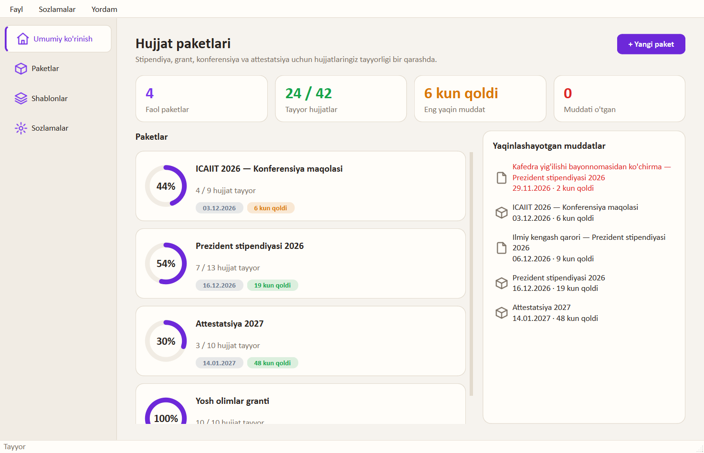
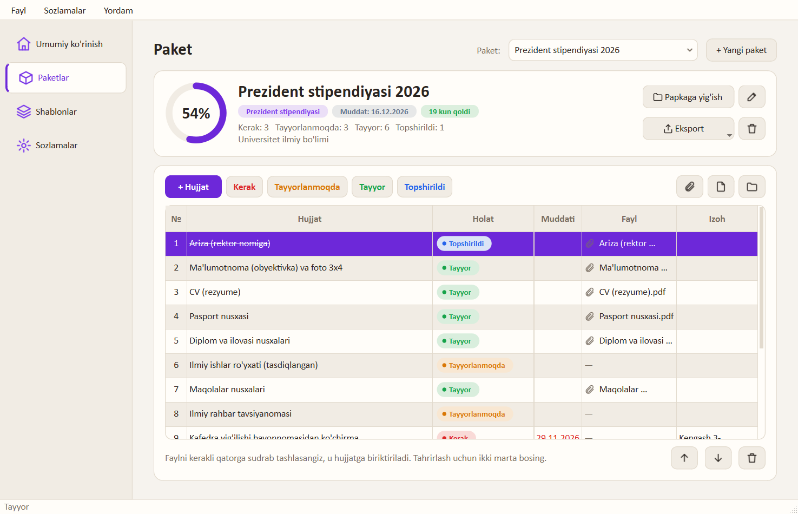
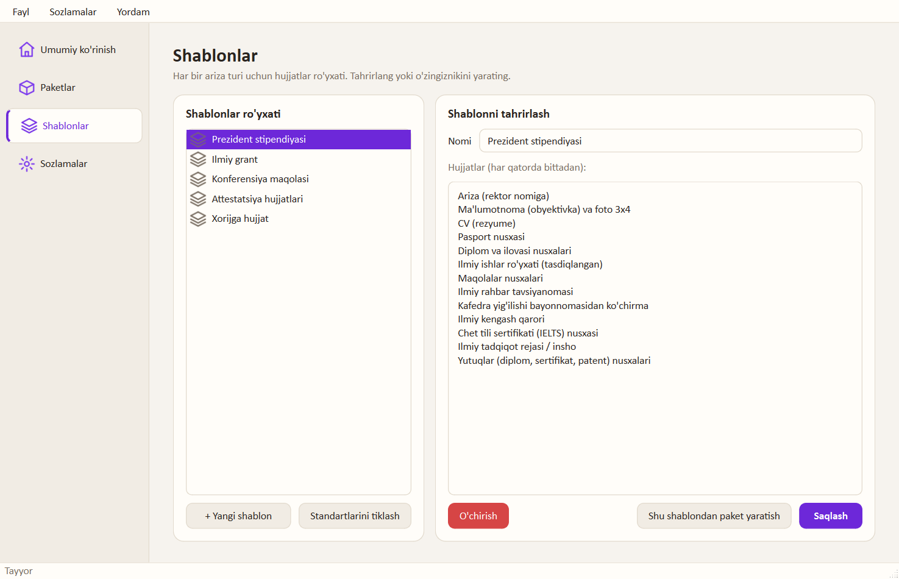
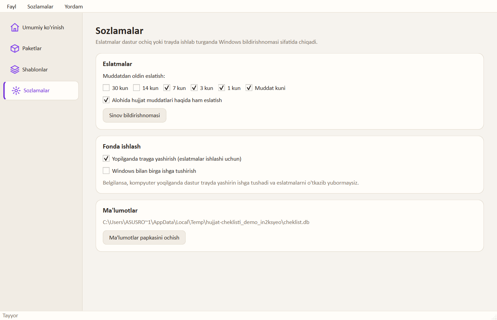
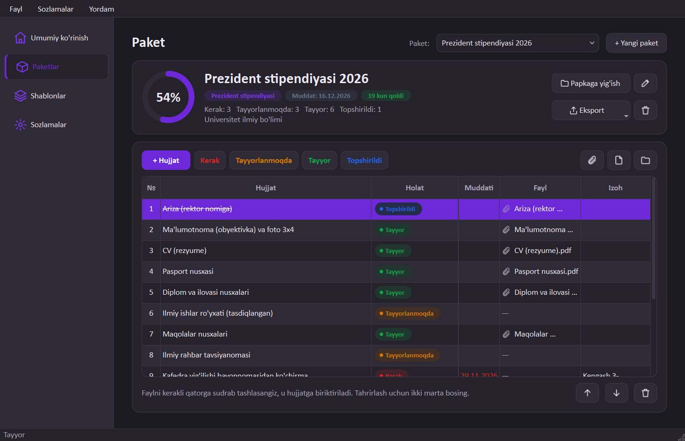
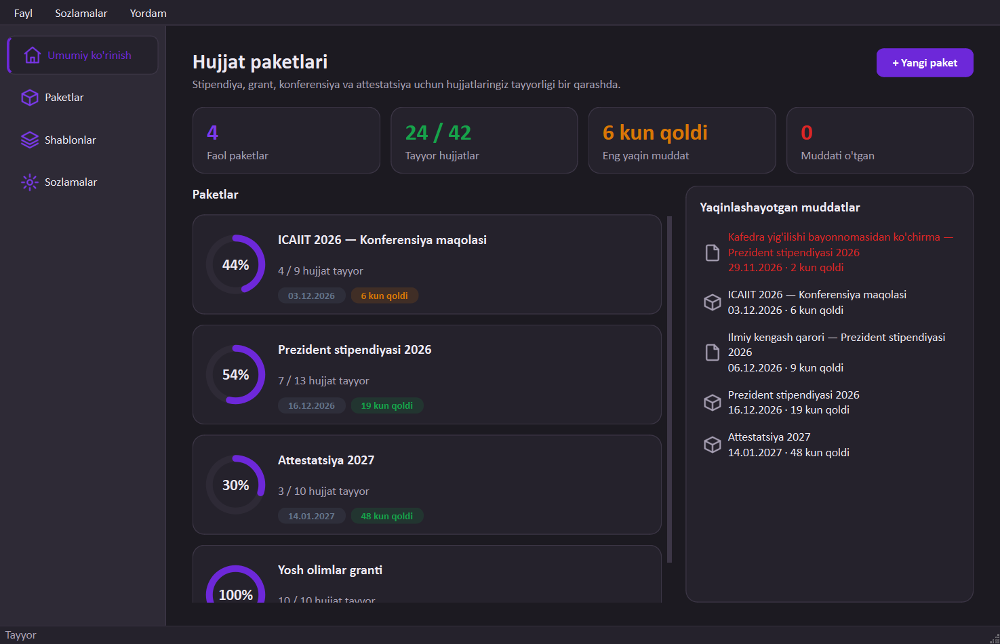

<h1 align="center">Stipendiya va hujjat chek-listi</h1>

<b>Scholarship & Document Checklist</b> · Чек-лист документов и стипендий

   
  
  
  
  

Stipendiya, grant, konferensiya, attestatsiya va xorijga safar uchun hujjat paketlarini kuzatuvchi dastur: tayyor shablonlar, har bir hujjat holati, biriktirilgan fayllar, muddat eslatmalari, PDF/Excel eksport va topshirish papkasini bir bosishda yig'ish.

## Imkoniyatlar

- 5 ta tayyor shablon (Prezident stipendiyasi, ilmiy grant, konferensiya, attestatsiya, xorijga hujjat) — tahrirlanadi
- Hujjat holatlari: kerak / tayyorlanmoqda / tayyor / topshirildi
- Faylni biriktirish (sudrab tashlash), ochish va papkasini ko'rsatish
- Har bir paket uchun tayyorlik halqasi va qolgan kunlar
- Muddatdan N kun oldin Windows bildirishnomasi (tray)
- Chek-listni PDF va Excel ga eksport
- Barcha fayllarni raqamlangan holda bitta papkaga yig'ish
- O'zbek, rus, ingliz tillari; yorug' va qorong'i mavzu; to'liq offline

## O'rnatish

1. [**HujjatCheklisti.exe**](https://github.com/eduhakimov/hujjat-cheklisti/releases/latest/download/HujjatCheklisti.exe) faylini yuklab oling.
2. Faylni ishga tushiring, o'rnatish shart emas.
3. Windows SmartScreen ogohlantirsa: **Batafsil → Baribir ishga tushirish**.

**Tizim talablari:** Windows 10 (1809+) / Windows 11, x64

---

## Русский

Программа для отслеживания пакетов документов на стипендии, гранты, конференции, аттестацию и поездки: готовые шаблоны, статус каждого документа, прикреплённые файлы, напоминания о сроках, экспорт в PDF/Excel и сбор папки для подачи одним щелчком.

- 5 готовых шаблонов (Президентская стипендия, грант, конференция, аттестация, выезд за рубеж) — редактируются
- Статусы: нужно / готовится / готово / сдано
- Прикрепление файлов (перетаскиванием), открытие файла и папки
- Кольцо готовности и оставшиеся дни для каждого пакета
- Уведомления Windows за N дней до срока (трей)
- Экспорт чек-листа в PDF и Excel
- Сбор всех файлов с нумерацией в одну папку
- Узбекский, русский, английский; светлая и тёмная тема; полностью офлайн

## English

Track document packages for scholarships, grants, conferences, attestation and travel abroad: ready templates, per-document status, attached files, deadline reminders, PDF/Excel export and one-click submission folder.

- 5 built-in editable templates (President scholarship, research grant, conference, attestation, abroad)
- Statuses: needed / in progress / ready / submitted
- Attach files (drag & drop), open file or folder
- Progress ring and days left for each package
- Windows notifications N days before deadlines (tray)
- Export checklist to PDF and Excel
- Collect all files, numbered, into one folder
- Uzbek, Russian, English; light and dark themes; fully offline

---

## Muallif / Author

**Bahtiyorjon Hakimov** (Hakimov Bahtiyorjon Muzaffar o'g'li), [github.com/eduhakimov](https://github.com/eduhakimov)

© 2026 Bahtiyorjon Hakimov. Barcha huquqlar himoyalangan. / Все права защищены. / All rights reserved.
Batafsil: [LICENSE](LICENSE) · Uchinchi tomon komponentlari: [THIRD_PARTY_NOTICES.md](THIRD_PARTY_NOTICES.md)
