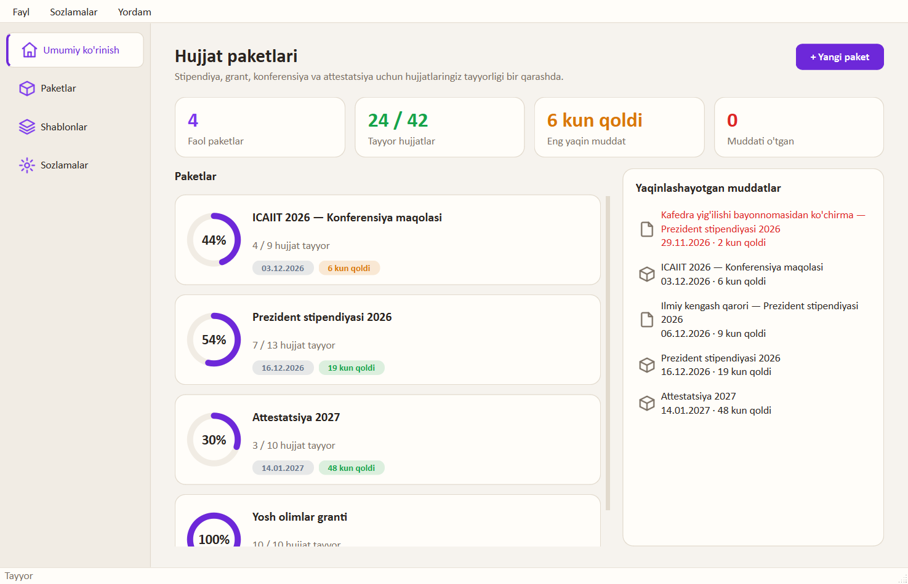
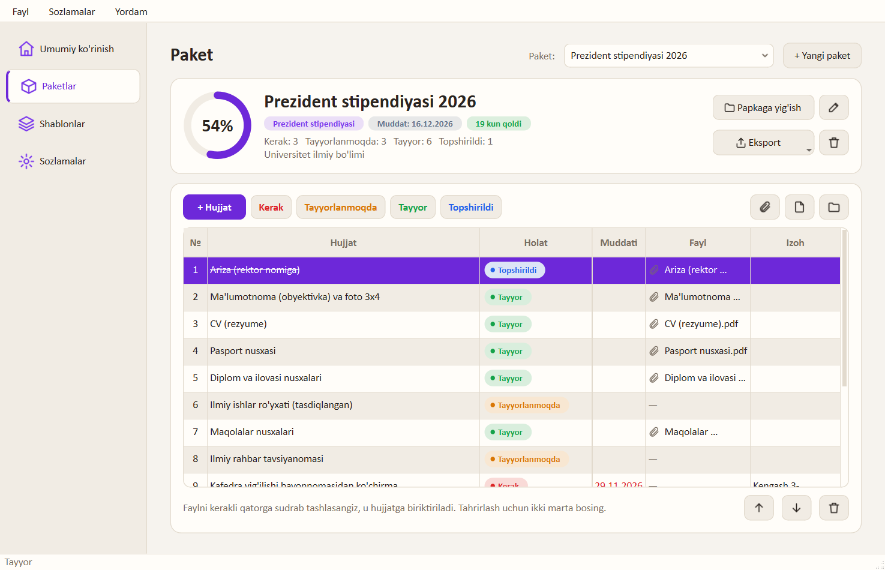
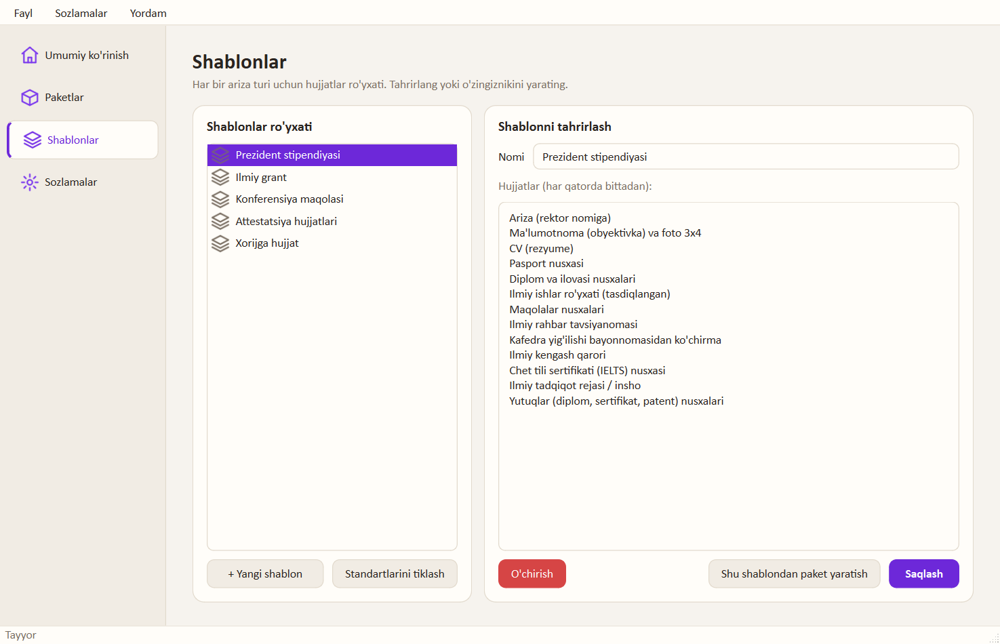
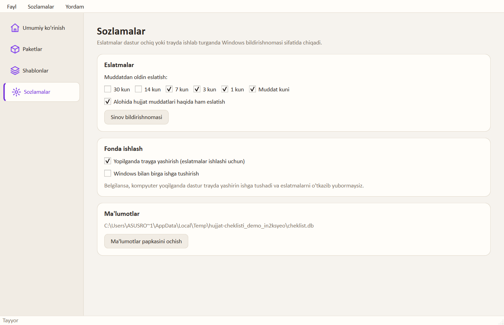
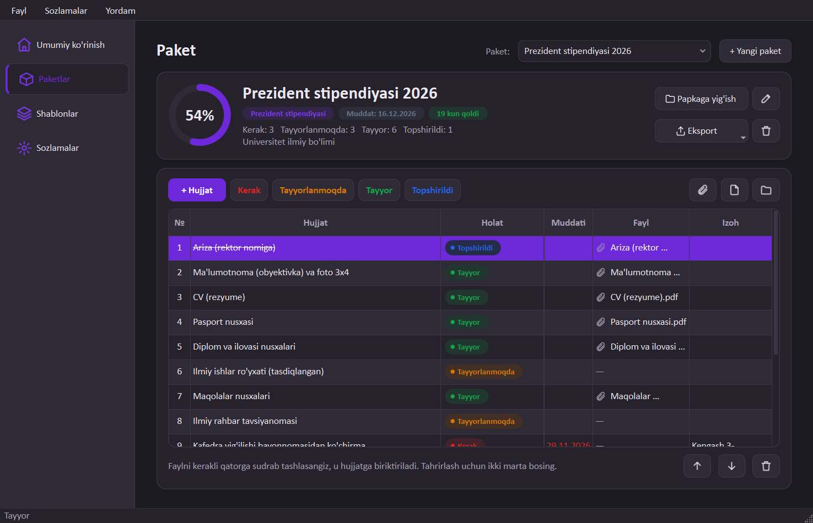

# Stipendiya va hujjat chek-listi: Foydalanish qo‘llanmasi

Muallif: Hakimov Bahtiyorjon. Versiya: 1.0.2.

## 1. Umumiy ma’lumot

“Stipendiya va hujjat chek-listi” – stipendiya, grant, konferensiya, attestatsiya va xorijga safar uchun hujjat paketlarini tayyorlashni kuzatuvchi dastur. Har bir paket uchun hujjatlar ro‘yxati tuziladi, har bir hujjatning holati belgilanadi, unga fayl biriktiriladi, muddat yaqinlashganda esa dastur Windows bildirishnomasi bilan eslatadi.

Dasturda beshta tayyor shablon bor: “Prezident stipendiyasi”, “Ilmiy grant”, “Konferensiya maqolasi”, “Attestatsiya hujjatlari” va “Xorijga hujjat”. Ularni tahrirlash yoki o‘z shabloningizni yaratish mumkin.

Topshirish vaqtida dastur barcha biriktirilgan fayllarni raqamlangan holda bitta papkaga yig‘adi va chek-listni PDF yoki Excel faylga chiqaradi.

Dastur talabalar, magistrantlar, tayanch doktorantlar, yosh olimlar, shuningdek ilmiy bo‘lim va xalqaro bo‘lim xodimlari uchun mo‘ljallangan.

Dastur bilan ishlashning umumiy tartibi: paket yaratish – hujjatlar holatini yangilab borish va fayllarni biriktirish – muddatlarni kuzatish – topshirish kuni fayllarni papkaga yig‘ish va chek-listni eksport qilish. Bir vaqtning o‘zida bir nechta paket yuritish mumkin, ularning barchasi “Umumiy ko‘rinish” sahifasida bir joyda ko‘rinadi.

## 2. Tizim talablari

- Operatsion tizim: Windows 10 (1809 yoki undan keyingi versiya) yoki Windows 11, 64 bitli (x64).
- Internet aloqasi talab qilinmaydi: dastur to‘liq oflayn ishlaydi.
- O‘rnatish shart emas: dastur bitta .exe fayldan iborat.
- Bildirishnomalar ko‘rinishi uchun Windows bildirishnomalari yoqilgan bo‘lishi kerak.
- Excel eksportni ochish uchun .xlsx formatini o‘qiydigan dastur, PDF ni ochish uchun PDF ko‘ruvchi kerak.

## 3. O‘rnatish va ishga tushirish

1. Dasturning GitHub sahifasidagi Releases bo‘limidan (https://github.com/eduhakimov/hujjat-cheklisti/releases) .exe faylni yuklab oling.
2. Faylni doimiy turadigan papkaga joylashtiring. “Windows bilan birga ishga tushirish” ni yoqmoqchi bo‘lsangiz, keyinchalik faylni boshqa joyga ko‘chirmang.
3. Faylni ikki marta bosib ishga tushiring.
Dastur ishga tushganda tayyor shablonlar avtomatik ravishda ma’lumotlar bazasiga yoziladi, shuning uchun ularni darhol ishlatish mumkin.

4. Birinchi ishga tushirishda Windows SmartScreen ogohlantirishi chiqishi mumkin. Bunday holda “Batafsil”, so‘ng “Baribir ishga tushirish” tugmasini bosing.
Dastlab “Umumiy ko‘rinish” sahifasida “Hali paket yo‘q” yozuvi chiqadi. “+ Yangi paket” tugmasini bosib ishni boshlang. Yangi versiyaga o‘tishda eski .exe faylni almashtirish kifoya: ma’lumotlar profilingizda saqlanadi.

## 4. Dastur oynasi bilan tanishish

Oyna yuqorisida menyu satri (“Fayl”, “Sozlamalar”, “Yordam”), chap tomonda esa to‘rtta sahifa yorlig‘i joylashgan.

**Umumiy ko‘rinish** (1-rasm). “Hujjat paketlari” sarlavhasi va “+ Yangi paket” tugmasi; to‘rtta ko‘rsatkich: “Faol paketlar”, “Tayyor hujjatlar”, “Eng yaqin muddat”, “Muddati o‘tgan”; “Paketlar” ro‘yxati tayyorlik halqalari bilan; o‘ngda “Yaqinlashayotgan muddatlar”.

**Paketlar** (2-rasm). Yuqorida “Paket:” tanlash ro‘yxati va “+ Yangi paket”. Paket kartochkasida tayyorlik foizi, shablon, muddat, qolgan kunlar, holatlar bo‘yicha hisob va tashkilot; o‘ngda “Papkaga yig‘ish”, “Eksport”, tahrirlash va o‘chirish tugmalari. Pastda “+ Hujjat”, holat tugmalari (“Kerak”, “Tayyorlanmoqda”, “Tayyor”, “Topshirildi”), fayl tugmalari va hujjatlar jadvali (“№”, “Hujjat”, “Holat”, “Muddati”, “Fayl”, “Izoh”). Jadval ostida yuqoriga, pastga surish va o‘chirish tugmalari.

**Shablonlar** (3-rasm). “Shablonlar ro‘yxati” va “Shablonni tahrirlash” panellari.

**Sozlamalar** (4-rasm). “Eslatmalar”, “Fonda ishlash” va “Ma’lumotlar” bo‘limlari.

*1-rasm. “Umumiy ko‘rinish” sahifasi: faol paketlar soni, tayyor hujjatlar (24 / 42), eng yaqin muddat va muddati o‘tganlar; paketlar tayyorlik halqalari bilan, o‘ngda “Yaqinlashayotgan muddatlar”*

*2-rasm. “Paketlar” sahifasi: “Prezident stipendiyasi 2026” paketi (54 %), holatlar bo‘yicha hisob, hujjatlar jadvali holat, muddat, biriktirilgan fayl va izoh ustunlari bilan*

*3-rasm. “Shablonlar” sahifasi: beshta tayyor shablon ro‘yxati va “Prezident stipendiyasi” shablonidagi hujjatlar ro‘yxatini tahrirlash*

*4-rasm. “Sozlamalar” sahifasi: muddatdan oldin eslatish kunlari, “Fonda ishlash” va “Ma’lumotlar” bo‘limlari*

## 5. Asosiy amallar

**Yangi paket yaratish**

1. “+ Yangi paket” tugmasini bosing (yoki Ctrl+N).
2. “Nomi” maydoniga paket nomini yozing, masalan, “Prezident stipendiyasi 2026”.
3. “Shablon” ro‘yxatidan shablonni tanlang yoki “Bo‘sh (shablonsiz)” ni qoldiring.
4. “Shablondagi hujjatlar” ro‘yxatida keraksiz hujjatlar belgisini olib tashlang.
5. Muddat bo‘lsa, “Muddat bor” bayrog‘ini belgilab, sanani kiriting.
6. Kerak bo‘lsa “Tashkilot” (qayerga topshiriladi) va “Izoh” ni to‘ldiring.
7. “Saqlash” ni bosing. Paket “Paketlar” sahifasida ochiladi.
**Hujjat holatini o‘zgartirish**

1. “Paketlar” sahifasida jadvaldan hujjatni tanlang.
2. Holat tugmalaridan birini bosing: “Kerak”, “Tayyorlanmoqda”, “Tayyor” yoki “Topshirildi”. Klaviaturada 1, 2, 3, 4 raqamlari ham shu vazifani bajaradi.
3. Tayyorlik foizi va holatlar hisobi darhol yangilanadi.
Tayyorlik foizi “Tayyor” va “Topshirildi” holatidagi hujjatlar ulushidan hisoblanadi. “Topshirildi” holatidagi hujjat nomi jadvalda chizib qo‘yiladi, shu bilan qaysi hujjatlar allaqachon topshirilgani darhol ko‘rinadi.

**Fayl biriktirish**

1. Faylni Windows Explorer oynasidan jadvaldagi kerakli hujjat qatoriga sudrab tashlang. Holat satrida “Biriktirildi” xabari chiqadi.
2. Yoki hujjatni tanlab, “Fayl biriktirish” tugmasini bosing va faylni tanlang.
3. “Faylni ochish” tugmasi faylni unga mos dasturda ochadi, papka tugmasi esa fayl turgan papkani ko‘rsatadi.
Fayl ko‘chirilgan yoki o‘chirilgan bo‘lsa, uning nomi qizil rangda ko‘rinadi. Faylni qayta biriktiring.

**Hujjat qo‘shish, tahrirlash va o‘chirish**

- “+ Hujjat” tugmasi yangi hujjat qo‘shadi.
- Hujjatni ikki marta bosish yoki F2 tahrirlash oynasini ochadi: nom, “Alohida muddat”, “Izoh” va fayl.
- Yuqoriga va pastga strelkali tugmalar hujjat tartibini o‘zgartiradi.
- Del tugmasi yoki savatcha tugmasi hujjatni ro‘yxatdan o‘chiradi (fayl diskda qoladi).
**Topshirishga tayyorlash: papkaga yig‘ish**

1. Paket kartochkasidagi “Papkaga yig‘ish” tugmasini bosing.
2. “Papka qayerda yaratilsin?” oynasida joyni tanlang.
3. Dastur barcha biriktirilgan fayllarni yangi papkaga nusxalaydi. Har bir fayl nomi tartib raqami (01, 02, ...) va hujjat nomidan iborat bo‘ladi.
4. Natijada nechta fayl nusxalangani va qaysi hujjatlarning fayli topilmagani ko‘rsatiladi.
Asl fayllar joyida qoladi va o‘zgarmaydi. Nusxalashni jarayon davomida bekor qilish mumkin.

**Paketni tahrirlash va o‘chirish**

1. Paket kartochkasidagi qalam belgili tugmani bosing. “Paketni tahrirlash” oynasida nom, muddat, tashkilot va izohni o‘zgartiring va saqlang.
2. Paketni o‘chirish uchun savatcha belgili tugmani bosing. Dastur paket va undagi barcha yozuvlar o‘chirilishini so‘raydi; fayllarning o‘zi o‘chirilmaydi.
**Umumiy ko‘rinishdan foydalanish**

- Ko‘rsatkich kartochkalari barcha faol paketlar bo‘yicha umumiy holatni ko‘rsatadi.
- Paket kartochkasini bosish uni “Paketlar” sahifasida ochadi.
- Ko‘rsatkichlar va kartochkalar hujjat holati o‘zgarishi bilan avtomatik yangilanadi, sahifani qayta ochish shart emas.
- “Yaqinlashayotgan muddatlar” ro‘yxatida paket belgisi paketning umumiy muddatini, hujjat belgisi esa alohida hujjat muddatini bildiradi. Qizil rang muddat juda yaqinligini yoki o‘tib ketganini anglatadi.
**Chek-listni eksport qilish**

1. “Eksport” menyusini oching.
2. “PDF ga eksport” yoki “Excel ga eksport” ni tanlang va fayl nomini kiriting.
3. Faylda hujjatlar ro‘yxati, holati, muddati, fayl nomi, izohi va tuzilgan sana bo‘ladi.
**Shablonlar bilan ishlash**

1. “Shablonlar” sahifasida ro‘yxatdan shablonni tanlang.
2. “Nomi” va hujjatlar ro‘yxatini tahrirlang (har qatorda bitta hujjat), “Saqlash” ni bosing.
3. Yangi shablon uchun “+ Yangi shablon”, o‘chirish uchun “O‘chirish” tugmasini bosing. Shablonni o‘chirish mavjud paketlarga ta’sir qilmaydi.
4. “Shu shablondan paket yaratish” tugmasi tanlangan shablon bilan yangi paket oynasini ochadi.
5. “Standartni tiklash” o‘rnatilgan shablonlarni dastlabki holatiga qaytaradi; ularga kiritgan o‘zgarishlaringiz yo‘qoladi, o‘z shablonlaringiz esa saqlanib qoladi.

## 6. Sozlamalar

- **Muddatdan oldin eslatish.** “30 kun”, “14 kun”, “7 kun”, “3 kun”, “1 kun”, “Muddat kuni” bayroqlaridan keraklilarini belgilang (standart: 7, 3, 1 kun va muddat kuni).
- **Alohida hujjat muddatlari haqida ham eslatish.** Yoqilgan bo‘lsa, hujjatga qo‘yilgan alohida muddatlar uchun ham eslatma chiqadi.
- **Sinov bildirishnomasi.** Bildirishnomalar ishlayotganini tekshiradi.
- **Yopilganda trayga yashirish (eslatmalar ishlashi uchun).** Yoqilgan bo‘lsa, oyna yopilganda dastur soat yonidagi tizim tepsisida ishlashda davom etadi. To‘liq chiqish uchun tepsi menyusidan “Dasturdan chiqish” ni tanlang.
- **Windows bilan birga ishga tushirish.** Belgilansa, kompyuter yoqilganda dastur tepsida yashirin ishga tushadi. Bu sozlama faqat siz belgilasangiz yoqiladi.
- **Ma’lumotlar papkasini ochish.** Baza fayli turgan papkani ochadi.
- **Menyular.** “Fayl” menyusida dasturdan chiqish, “Yordam” menyusida dastur ichidagi qisqa “Qo‘llanma” va “Dastur haqida” bandlari bor.
- **Til va mavzu.** “Sozlamalar” menyusidagi “Til” (o‘zbek, rus, ingliz) va “Mavzu” (“Yorug‘”, “Qorong‘i”, “Tizim bo‘yicha”) bandlari. Qorong‘i mavzu 5-rasmda ko‘rsatilgan.

*5-rasm. “Paketlar” sahifasi qorong‘i mavzuda*

## 7. Ma’lumotlarni saqlash va xavfsizlik

- Paketlar, hujjatlar, shablonlar va ko‘rsatilgan eslatmalar ro‘yxati %APPDATA%\BahtiyorSoft\hujjat-cheklisti papkasidagi SQLite baza faylida saqlanadi. Uning to‘liq yo‘li “Sozlamalar” sahifasidagi “Ma’lumotlar” bo‘limida ko‘rsatiladi.
- Dastur fayllaringizni o‘z papkasiga ko‘chirmaydi, faqat ularning joyini eslab qoladi. Shuning uchun biriktirilgan fayllarni o‘chirmang va ko‘chirmang yoki ko‘chirgandan so‘ng qayta biriktiring.
- Paket yoki hujjatni o‘chirish diskdagi fayllarni o‘chirmaydi.
- “Papkaga yig‘ish” fayllarning nusxasini yaratadi, asl fayllar o‘zgarmaydi; mavjud fayl ustiga yozilmaydi.
- Baza fayli buzilgan bo‘lsa, dastur uni sana qo‘shilgan nom bilan zaxiraga ko‘chirib, yangi baza bilan ishga tushadi.
- Dastur internetga ulanmaydi va ma’lumotlaringizni hech qayerga yubormaydi.
- Hujjatlaringiz (pasport nusxasi, diplom va boshqalar) shaxsiy ma’lumot hisoblanadi. Ularni himoyalangan papkada saqlang va zaxira nusxasini oling.
- Ma’lumotlarni zaxiralash uchun dasturni yopib, baza fayli turgan papkani (“Ma’lumotlar papkasini ochish” tugmasi orqali) nusxalang. Boshqa kompyuterga ko‘chirishda biriktirilgan fayllar ham ko‘chirilishi va kerak bo‘lsa qayta biriktirilishi lozim.

## 8. Ko‘p uchraydigan savollar va muammolar

**Fayl nomi qizil rangda ko‘rsatilmoqda.** Fayl ko‘chirilgan, qayta nomlangan yoki o‘chirilgan. Dastur faylning faqat joyini eslab qoladi, shuning uchun faylni yangi joyidan qayta biriktiring. Fayl tashqi diskda yoki fleshkada bo‘lsa, qurilma ulanganini tekshiring.

**Bildirishnoma chiqmadi.** Dastur ochiq yoki tepsida ishlab turganini, “Yopilganda trayga yashirish” yoqilganini tekshiring. “Sinov bildirishnomasi” tugmasidan foydalaning va Windows sozlamalarida bildirishnomalar yoqilganini tekshiring.

**Muddatni o‘zgartirdim, eslatma qayta keladimi?** Ha. Yangi sana uchun eslatmalar qaytadan hisoblanadi.

**Eski muddat haqida eslatma kelmadi.** Muddati uch kundan ko‘p o‘tib ketgan sanalar haqida dastur eslatmaydi. Bunday paketlarni yangilang yoki o‘chiring.

**Bir nechta hujjatga bitta fayl kerak (masalan, umumiy skan).** Faylni har bir hujjatga alohida biriktiring. “Papkaga yig‘ish” da u har bir hujjat nomi bilan alohida nusxalanadi.

**Holatni tez o‘zgartirish mumkinmi?** Ha. Hujjatni tanlab, klaviaturadagi 1 (“Kerak”), 2 (“Tayyorlanmoqda”), 3 (“Tayyor”) yoki 4 (“Topshirildi”) tugmasini bosing.

**Paket ro‘yxatda ko‘rinmayapti.** “Paketlar” sahifasidagi “Paket:” ro‘yxatini oching va kerakli paketni tanlang. “Umumiy ko‘rinish” sahifasida esa barcha faol paketlar kartochka ko‘rinishida chiqadi.

**Standart shablonni tasodifan o‘zgartirib yubordim.** “Shablonlar” sahifasidagi “Standartni tiklash” tugmasini bosing. O‘z shablonlaringiz saqlanib qoladi.

**“Papkaga yig‘ish” dan keyin ba’zi fayllar yo‘q.** Natija xabarida fayli topilmagan hujjatlar sanab o‘tiladi. Ularning faylini biriktiring va yig‘ishni takrorlang.

**“Eksport qilib bo‘lmadi” xabari chiqdi.** Shu nomli fayl boshqa dasturda (masalan, Excel’da) ochiq bo‘lishi mumkin. Uni yoping yoki boshqa nom bering.

**Shablonni o‘zgartirdim, lekin paketdagi ro‘yxat o‘zgarmadi.** Paket yaratilganda shablon ro‘yxati nusxalanadi. Mavjud paketga yangi hujjatni “+ Hujjat” orqali qo‘shing.

**Oynani yopdim, lekin dastur ishlayapti.** Eslatmalar ishlashi uchun dastur tepsida qoladi. Chiqish uchun tepsi menyusidan “Dasturdan chiqish” ni tanlang.

**SmartScreen dasturni ochishga ruxsat bermayapti.** “Batafsil”, so‘ng “Baribir ishga tushirish” ni bosing. Faylni faqat rasmiy GitHub sahifasidan yuklab oling, boshqa manbalardan olingan nusxalarni ishga tushirmang.

