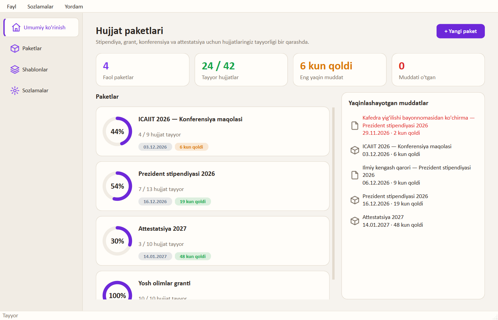
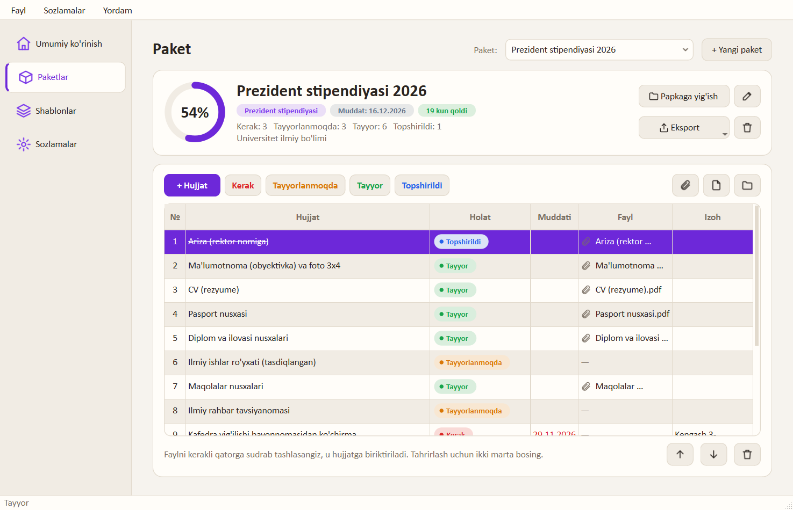
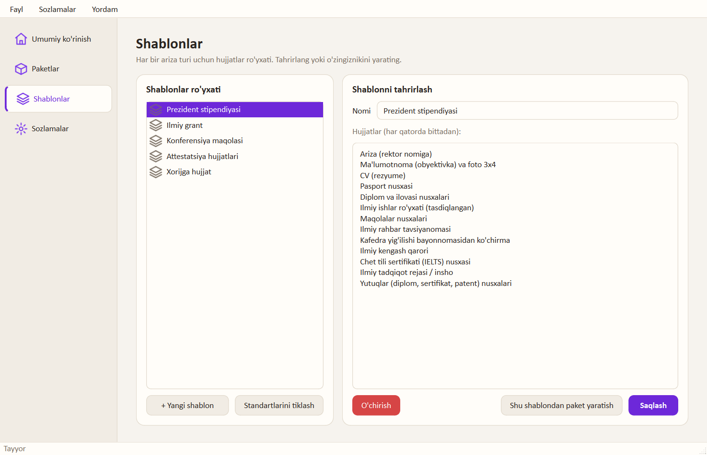
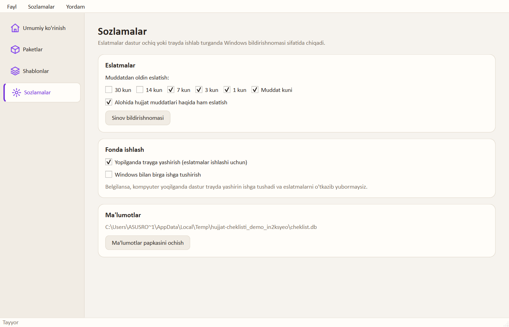

UDK: 004.42:378.4

# Stipendiya, grant, konferensiya va attestatsiya hujjat paketlarining tayyorligini nazorat qiluvchi oflayn dasturiy vosita: arxitektura va amalga oshirish

**Hakimov Bahtiyorjon**  
*[ish joyi, lavozimi, elektron pochta]*

**Annotatsiya.** Maqolada stipendiya, ilmiy grant, konferensiya, attestatsiya va xorijga safar uchun talab qilinadigan hujjat paketlarini tayyorlash jarayonini nazorat qiluvchi “Stipendiya va hujjat chek-listi” dasturiy vositasi tavsiflanadi. Dastur Python 3.12, PySide6 va SQLite asosida yaratilgan va internetsiz ishlaydi. Unda beshta tahrirlanadigan tayyor shablon, har bir hujjat uchun to‘rt bosqichli holat (kerak, tayyorlanmoqda, tayyor, topshirildi), fayllarni sudrab tashlash orqali biriktirish, paket tayyorligini foizda ko‘rsatuvchi halqa va qolgan kunlar, muddatdan belgilangan kunlar oldin Windows bildirishnomasi, chek-listni PDF va Excel formatlariga eksport qilish hamda biriktirilgan fayllarni raqamlangan holda bitta topshirish papkasiga yig‘ish amalga oshirilgan. Ishonchlilik 21 ta avtomatik test bilan tekshirilgan.

*Kalit so‘zlar:* hujjat paketi, chek-list, stipendiya, ilmiy grant, muddat nazorati, SQLite, oflayn dastur.

**Офлайн-программное средство контроля готовности пакетов документов для стипендий, грантов, конференций и аттестации: архитектура и реализация**

**Аннотация.** В статье описывается программное средство «Чек-лист стипендии и документов», контролирующее подготовку пакетов документов для стипендий, научных грантов, конференций, аттестации и выезда за рубеж. Программа разработана на Python 3.12, PySide6 и SQLite и работает без интернета. Реализованы пять редактируемых встроенных шаблонов, четырёхэтапный статус каждого документа (нужно, готовится, готово, сдано), прикрепление файлов перетаскиванием, кольцевой индикатор готовности пакета в процентах и оставшиеся дни, уведомления Windows за заданное число дней до срока, экспорт чек-листа в PDF и Excel, а также сбор прикреплённых файлов с нумерацией в одну папку для сдачи. Надёжность проверена 21 автоматическим тестом.

*Ключевые слова:* пакет документов, чек-лист, стипендия, научный грант, контроль сроков, SQLite, офлайн-приложение.

**An offline software tool for tracking the readiness of document packages for scholarships, grants, conferences and attestation: architecture and implementation**

**Abstract.** The paper describes the Scholarship and Document Checklist, a software tool that tracks the preparation of document packages required for scholarships, research grants, conferences, attestation and travel abroad. The program is built with Python 3.12, PySide6 and SQLite and works offline. It provides five editable built-in templates, a four-stage status for each document (needed, in progress, ready, submitted), file attachment by drag and drop, a ring indicator of package readiness in percent with days remaining, Windows notifications a configurable number of days before the deadline, export of the checklist to PDF and Excel, and collection of attached files with numbering into a single submission folder. Reliability is verified by 21 automated tests.

*Keywords:* document package, checklist, scholarship, research grant, deadline tracking, SQLite, offline application.

## Kirish

Talaba, magistrant, tayanch doktorant va yosh olimning ilmiy-ta’limiy faoliyati muntazam ravishda turli tanlov va jarayonlarga hujjat topshirish bilan bog‘liq: davlat stipendiyalari, ilmiy grantlar, xalqaro konferensiyalar, attestatsiya, xorijiy ta’lim va stajirovka dasturlari. Har bir jarayon o‘ziga xos hujjatlar ro‘yxatini talab qiladi: ariza, ma’lumotnoma (obyektivka), rezyume, pasport va diplom nusxalari, ilmiy ishlar ro‘yxati, maqolalar nusxalari, ilmiy rahbar tavsiyanomasi, kafedra yig‘ilishi bayonnomasidan ko‘chirma, ilmiy kengash qarori, chet tili sertifikati va boshqalar.

Bu hujjatlar turli shaxslar va bo‘linmalardan, turli vaqtda olinadi va ularning tayyorlanishi bir necha hafta davom etishi mumkin. Shu jarayonda bir hujjat unutilishi, imzolanmay qolishi yoki faylining qayerda saqlangani esdan chiqishi oddiy holdir. Topshirish muddati yaqinlashganda esa barcha fayllarni bir joyga to‘plash, ularni to‘g‘ri nomlash va tartiblash qo‘shimcha vaqt talab qiladi. Bir vaqtning o‘zida bir nechta paket ustida ishlash (masalan, stipendiya va konferensiya) vaziyatni yanada murakkablashtiradi.

Amaliyotda bunday nazorat qog‘ozdagi ro‘yxat, matn fayli yoki xabar almashish dasturidagi eslatmalar orqali yuritiladi. Ular hujjat holatini bosqichma-bosqich kuzatish, faylni hujjat bilan bog‘lash va muddat yaqinlashganda ogohlantirish imkonini bermaydi.

Ta’lim va ilm-fanni raqamlashtirish, jumladan “Raqamli O‘zbekiston – 2030” strategiyasida belgilangan vazifalar, tadqiqotchilarning tashkiliy ishlarini yengillashtiruvchi mahalliy dasturiy vositalarga ehtiyojni oshiradi. Ushbu maqolada shunday vositalardan biri – “Stipendiya va hujjat chek-listi” dasturining vazifasi, arxitekturasi, asosiy algoritmlari va sinov natijalari bayon etiladi.

Vosita ilmiy faoliyat bilan bog‘liq jarayonlarga yo‘naltirilgan bo‘lsa-da, uning modeli – hujjatlar ro‘yxati, holatlar, fayllar va muddatlar – istalgan hujjat paketi uchun umumiy hisoblanadi. Shu sababli undan ishga kirish, xorijga safar yoki boshqa ma’muriy jarayonlar uchun ham foydalanish mumkin.

## Muammoning qo‘yilishi va mavjud yechimlar tahlili

Tadqiqot maqsadi – bir nechta hujjat paketini bir vaqtda yurituvchi, har bir hujjatning tayyorlik holatini va unga tegishli faylni saqlovchi, muddatlar haqida ogohlantiruvchi va topshirish uchun barcha fayllarni bir joyga yig‘uvchi oflayn ish stoli ilovasini ishlab chiqish. Maqsadga erishish uchun quyidagi vazifalar qo‘yildi:

- tipik jarayonlar uchun tayyor, foydalanuvchi tahrirlay oladigan hujjatlar shablonlarini yaratish;
- paket va hujjatlar uchun ma’lumotlar bazasi tuzilmasini loyihalash, jumladan paketning umumiy muddati va alohida hujjat muddatlarini qo‘llab-quvvatlash;
- hujjat holatini bosqichlarga ajratish va paket tayyorligini miqdoriy ko‘rsatish;
- hujjatga faylni biriktirish va fayl mavjudligini nazorat qilish;
- muddatdan oldin bir necha chegarada eslatma berish, bunda har bir eslatmani faqat bir marta ko‘rsatish;
- chek-listni hisobot sifatida PDF va Excel formatlariga chiqarish;
- biriktirilgan fayllarni asl nusxalarni o‘zgartirmasdan, tartib raqami bilan bitta papkaga nusxalash.
Mavjud yechimlarni umumiy turlarga ajratish mumkin. Birinchi tur – umumiy maqsadli vazifalar menejerlari va eslatma dasturlari. Ular vazifalar ro‘yxati va eslatmalarni yaxshi boshqaradi, ammo hujjat paketi, hujjatning bosqichli holati va fayl biriktirish kabi tushunchalarni maxsus qo‘llab-quvvatlamaydi, ko‘pincha bulutli xizmatga ulanishni talab qiladi. Ikkinchi tur – jadval fayllari: ular moslashuvchan, biroq eslatma bermaydi va fayllarni yig‘ish imkoniga ega emas. Uchinchi tur – tashkilotlarning elektron ariza qabul qilish tizimlari: ular topshirish bosqichini qamrab oladi, lekin hujjatlarni tayyorlash jarayonini foydalanuvchi kompyuterida nazorat qilishga mo‘ljallanmagan.

Shu sababli ishlab chiqiladigan vosita uchun quyidagi talablar shakllantirildi: o‘rnatishsiz ishga tushadigan bitta fayl; internetsiz ishlash; foydalanuvchi fayllarini hech qachon o‘zgartirmaslik va o‘chirmaslik; o‘zbek, rus va ingliz tilidagi interfeys; oyna yopilganda ham eslatmalarning ishlashi; avtomatik ishga tushirishni faqat foydalanuvchi ruxsati bilan yoqish.

Yechimning sifat mezonlari ham belgilandi: tayyorlik foizi har doim hujjatlar holatiga mos bo‘lishi; har bir eslatma faqat bir marta, kerakli chegarada chiqishi; muddat o‘zgartirilganda eslatma yangi sana uchun qayta ishlashi; buzilgan ma’lumotlar bazasi dasturni ishdan chiqarmasligi; fayllarni yig‘ish jarayoni bekor qilinganda yoki fayl nomida Unicode belgilar bo‘lganda to‘g‘ri ishlashi.

## Tadqiqot metodologiyasi va dasturiy arxitektura

Dastur Python 3.12 tilida yozilgan, grafik interfeys Qt 6 asosidagi PySide6 kutubxonasida yaratilgan. Ma’lumotlar Python standart kutubxonasidagi sqlite3 moduli orqali SQLite ma’lumotlar bazasida saqlanadi, Excel eksport openpyxl kutubxonasi yordamida, PDF eksport esa Qt chop etish moduli orqali amalga oshiriladi. Bildirishnomalar tizim tepsisidagi belgi (QSystemTrayIcon) orqali chiqariladi. Dastur PyInstaller yordamida bitta .exe faylga yig‘iladi. Uchinchi tomon komponentlari va litsenziyalari THIRD PARTY NOTICES hujjatida keltirilgan.

Kod quyidagi modullarga ajratilgan:

- **db** – SQLite bazasi: jadvallar tuzilmasi, shablonlar, paketlar va hujjatlar bilan ishlash, eslatmalar jurnali, buzilgan bazani zaxiralash;
- **logic** – interfeysdan mustaqil mantiq: tayyorlik foizi, holatlar soni, qolgan kunlar, shoshilinchlik rangi, eslatmalarni hisoblash, xavfsiz fayl nomi va fayllarni yig‘ish;
- **templates** – beshta tayyor shablon va ulardagi hujjatlar nomlari uch tilda;
- **ui extra** moduli – tizim tepsisi, avtomatik ishga tushirish, belgilar, halqa ko‘rsatkich va PDF chiqarish;
- **window** – asosiy oyna va to‘rtta sahifa: “Umumiy ko‘rinish”, “Paketlar”, “Shablonlar”, “Sozlamalar”;
- **strings** – o‘zbek, rus va ingliz tilidagi interfeys matnlari;
- **uzkit** – menyu, til, mavzu, sozlamalar va fayl yo‘llari uchun umumiy karkas.
Ma’lumotlar bazasi tuzilmasi oltita jadvaldan iborat: shablonlar, shablon bandlari, paketlar, paket hujjatlari, ko‘rsatilgan eslatmalar va xizmat ma’lumotlari. Paket nomi, turi, umumiy muddati, tashkilot, izoh, arxiv belgisi va yaratilgan sanasi bilan saqlanadi. Hujjat yozuvi nomi, holati, biriktirilgan fayl yo‘li, izohi, alohida muddati va tartib raqamidan iborat. Bog‘liqliklar tashqi kalitlar va kaskadli o‘chirish bilan ta’minlangan: paket o‘chirilganda uning hujjat yozuvlari ham o‘chadi, biroq diskdagi fayllarning o‘ziga tegilmaydi.

Tayyor shablonlar: “Prezident stipendiyasi” (13 ta hujjat), “Ilmiy grant” (10 ta), “Konferensiya maqolasi” (9 ta), “Attestatsiya hujjatlari” (10 ta) va “Xorijga hujjat” (11 ta). Shablonlar bazaga dastlabki ishga tushirishda yoziladi, foydalanuvchi ularni tahrirlashi, o‘z shablonini yaratishi yoki o‘rnatilgan shablonlarni dastlabki holatiga qaytarishi mumkin. Paket shablondan yaratilganda hujjatlar ro‘yxati nusxalanadi, shuning uchun keyinchalik shablonni o‘zgartirish mavjud paketlarga ta’sir qilmaydi.

Shablonlar uch tilda saqlanadi: dastlabki ishga tushirishda hujjatlar nomlari interfeys tiliga mos ravishda bazaga yoziladi. Bu, masalan, rus tilida ta’lim olayotgan talabaga hujjatlar ro‘yxatini o‘z tilida ko‘rish imkonini beradi.

Holatlar va tayyorlik. Hujjat to‘rt holatdan birida bo‘ladi: “Kerak”, “Tayyorlanmoqda”, “Tayyor”, “Topshirildi”. Paket tayyorligi “Tayyor” yoki “Topshirildi” holatidagi hujjatlarning umumiy hujjatlar soniga nisbati sifatida hisoblanadi va halqa ko‘rsatkichda foizda chiqariladi. Muddatgacha qolgan kunlar soniga qarab shoshilinchlik rangi tanlanadi: paket to‘liq tayyor bo‘lsa yashil; muddat o‘tgan yoki uch kundan kam qolgan bo‘lsa qizil; o‘n to‘rt kungacha qolgan bo‘lsa to‘q sariq; undan ko‘p bo‘lsa yashil; muddatsiz paket kulrang.

Eslatmalar algoritmi. Foydalanuvchi muddatdan oldin eslatish chegaralarini tanlaydi: 30, 14, 7, 3, 1 kun va muddat kuni (standart holatda 7, 3, 1 kun va muddat kuni). Har bir muddat (paketning umumiy muddati va, agar yoqilgan bo‘lsa, alohida hujjat muddatlari) uchun qolgan kunlar hisoblanadi va ular tushgan eng yaqin chegara aniqlanadi. Eslatma kaliti paket yoki hujjat identifikatori, muddat sanasi va chegara belgisidan tuziladi; ko‘rsatilgan kalitlar bazada saqlanadi, shuning uchun bir eslatma qayta ko‘rsatilmaydi. Muddat o‘zgartirilganda kalit ham o‘zgaradi va eslatma yangi sana uchun qayta ishlaydi. Muddati o‘tgan sanalar uchun bitta “muddat o‘tdi” eslatmasi beriladi, uch kundan ortiq o‘tgan eski muddatlar haqida eslatilmaydi.

Fayllarni yig‘ish. Paketdagi biriktirilgan fayllar foydalanuvchi tanlagan joyda yaratilgan yangi papkaga nusxalanadi. Har bir faylga hujjatning tartib raqami (01, 02, ...) va hujjat nomidan tuzilgan nom beriladi, Windows fayl nomlarida taqiqlangan belgilar almashtiriladi, asl kengaytma saqlanadi. Bir xil nomli fayl mavjud bo‘lsa, nomga qavs ichida raqam qo‘shiladi, ya’ni hech bir fayl ustiga yozilmaydi. Topilmagan fayllar alohida ro‘yxat bilan foydalanuvchiga ko‘rsatiladi. Jarayon foizli ko‘rsatkich bilan bajariladi va bekor qilinishi mumkin. Asl fayllar o‘zgartirilmaydi.

Interfeys va sozlamalarning barqarorligi. Dastur sozlamalari (eslatma chegaralari, tepsiga yashirish, alohida hujjat muddatlari haqida eslatish) alohida sozlamalar faylida saqlanadi. Yuklashda ularning turi va qiymati tekshiriladi: noto‘g‘ri yoki shikastlangan qiymatlar standart qiymatlar bilan almashtiriladi, shu tufayli qo‘lda tahrirlangan yoki eski versiyadan qolgan sozlamalar dasturni ishdan chiqarmaydi. Bu xususiyat alohida avtomatik testlar bilan tekshirilgan.

Saqlash va xavfsizlik. Baza foydalanuvchi profilidagi %APPDATA%\BahtiyorSoft\hujjat-cheklisti papkasida joylashgan. Baza fayli buzilgan bo‘lsa, u sana va vaqt qo‘shilgan nom bilan zaxiraga ko‘chiriladi va yangi baza yaratiladi, shuning uchun dastur ishga tushmay qolmaydi. Dastur fayllarning faqat yo‘lini saqlaydi, ularni o‘z papkasiga ko‘chirmaydi. Internetga murojaat qilinmaydi. Windows bilan birga ishga tushirish faqat foydalanuvchi bayroqni belgilaganda yoqiladi.

Ma’lumot oqimi quyidagicha. Foydalanuvchi shablondan paket yaratadi va keraksiz hujjatlarni olib tashlaydi; hujjat holati o‘zgarganda yoki fayl biriktirilganda o‘zgarish darhol bazaga yoziladi va “Umumiy ko‘rinish” hamda paket sahifasidagi ko‘rsatkichlar qayta hisoblanadi. Fonda ishlovchi taymer muddatlarni davriy tekshirib, kerakli eslatmalarni chiqaradi. Topshirish bosqichida foydalanuvchi chek-listni eksport qiladi va fayllarni bitta papkaga yig‘adi.

## Amalga oshirish va asosiy funksiyalar

Asosiy oyna chap tomonida to‘rtta sahifa yorlig‘i joylashgan: “Umumiy ko‘rinish”, “Paketlar”, “Shablonlar” va “Sozlamalar”.

“Umumiy ko‘rinish” sahifasi (1-rasm) to‘rtta ko‘rsatkich kartochkasi bilan boshlanadi: faol paketlar soni, tayyor hujjatlar soni umumiy son bilan, eng yaqin muddatgacha qolgan kunlar va muddati o‘tgan hujjatlar soni. Ularning ostida har bir paket kartochka ko‘rinishida tayyorlik halqasi, “N / M hujjat tayyor” yozuvi, muddat va qolgan kunlar bilan chiqadi. O‘ng tomonda “Yaqinlashayotgan muddatlar” ro‘yxati paket va alohida hujjat muddatlarini sana bo‘yicha tartiblab ko‘rsatadi; shoshilinch muddatlar qizil rangda ajratiladi. “+ Yangi paket” tugmasi (Ctrl+N) yangi paket yaratish oynasini ochadi: unda nom, shablon, muddat, tashkilot va izoh kiritiladi, shablondagi keraksiz hujjatlar belgisi olib tashlanadi.

“Paketlar” sahifasi (2-rasm) tanlangan paketning tafsilotlarini ko‘rsatadi: tayyorlik halqasi, shablon nomi, muddat va qolgan kunlar, har bir holat bo‘yicha hujjatlar soni va tashkilot. Yuqori o‘ng qismda “Papkaga yig‘ish”, “Eksport” (PDF yoki Excel), paketni tahrirlash va o‘chirish tugmalari bor. Hujjatlar jadvalida tartib raqami, hujjat nomi, holat, muddat, biriktirilgan fayl va izoh ustunlari joylashgan. Holat “Kerak”, “Tayyorlanmoqda”, “Tayyor”, “Topshirildi” tugmalari yoki klaviaturadagi 1–4 raqamlari bilan o‘zgartiriladi; topshirilgan hujjat nomi chizib qo‘yiladi. Fayl Windows Explorer oynasidan kerakli qatorga sudrab tashlash yoki “Fayl biriktirish” tugmasi bilan biriktiriladi, “Faylni ochish” va papkani ochish tugmalari bilan ko‘riladi; fayl topilmasa, uning nomi qizil rangda ko‘rsatiladi. Hujjatlarni yuqoriga va pastga surish, ikki marta bosib yoki F2 bilan tahrirlash, Del bilan o‘chirish mumkin. Qorong‘i mavzudagi ko‘rinish 5-rasmda keltirilgan.

“Shablonlar” sahifasi (3-rasm) chapda shablonlar ro‘yxatini, o‘ngda tanlangan shablonni tahrirlash maydonini ko‘rsatadi: nom va har qatorda bitta hujjat yozilgan ro‘yxat. “+ Yangi shablon”, “Standartni tiklash”, “O‘chirish”, “Shu shablondan paket yaratish” va “Saqlash” tugmalari mavjud. Shablonni o‘chirish mavjud paketlarga ta’sir qilmaydi.

“Sozlamalar” sahifasi (4-rasm) “Eslatmalar” bo‘limida muddatdan oldin eslatish kunlarini (30, 14, 7, 3, 1 kun, muddat kuni), “Alohida hujjat muddatlari haqida ham eslatish” bayrog‘ini va “Sinov bildirishnomasi” tugmasini; “Fonda ishlash” bo‘limida “Yopilganda trayga yashirish (eslatmalar ishlashi uchun)” va “Windows bilan birga ishga tushirish” bayroqlarini; “Ma’lumotlar” bo‘limida esa baza fayli yo‘li va “Ma’lumotlar papkasini ochish” tugmasini o‘z ichiga oladi.

Eksport qilingan PDF va Excel fayllarida paket nomi, hujjatlar ro‘yxati, ularning holati, muddati, fayl nomi va izohi hamda tuzilgan sana bo‘ladi. Bu chek-listni ilmiy rahbar yoki mas’ul xodimga yuborish, chop etib hujjatlar papkasiga qo‘yish uchun qulay.

Klaviatura bilan ishlash ham ko‘zda tutilgan: Ctrl+N yangi paket oynasini ochadi, 1–4 raqamlari tanlangan hujjat holatini o‘zgartiradi, F2 tahrirlaydi, Del esa o‘chiradi. Bu ko‘p hujjatli paketlarda holatlarni tez yangilash imkonini beradi. Har bir muhim amal (paket, hujjat yoki shablonni o‘chirish, standart shablonlarni tiklash) oldidan foydalanuvchidan tasdiq so‘raladi, tasdiq matnida esa amalning oqibati, masalan, fayllarning o‘zi o‘chirilmasligi ko‘rsatiladi.

Odatiy ish ssenariysi quyidagicha. Magistrant Prezident stipendiyasiga hujjat topshirishni rejalashtiradi: “Prezident stipendiyasi” shablonidan paket yaratadi, muddatni kiritadi va kerak bo‘lmagan bandni olib tashlaydi. Keyingi haftalarda u har bir hujjat tayyorlanishi bilan holatni o‘zgartiradi va skanerlangan faylni qatorga sudrab tashlaydi. Kafedra yig‘ilishi bayonnomasidan ko‘chirma uchun alohida muddat qo‘yadi. Muddat yaqinlashganda u bildirishnoma oladi, “Umumiy ko‘rinish” sahifasida qolgan hujjatlarni ko‘radi. Topshirish kuni u “Papkaga yig‘ish” orqali barcha fayllarni raqamlangan holda bitta papkaga oladi va chek-listni PDF ga eksport qiladi.

Ilmiy bo‘lim xodimi uchun ssenariy shunga o‘xshash: u bir vaqtda bir nechta grant arizasi bo‘yicha paketlar yuritadi, har birida mas’ul shaxslar va oraliq muddatlarni izohlarda qayd etadi va “Umumiy ko‘rinish” sahifasida barcha arizalar tayyorligini bir qarashda kuzatadi.

*1-rasm. “Umumiy ko‘rinish” sahifasi: faol paketlar soni, tayyor hujjatlar (24 / 42), eng yaqin muddat va muddati o‘tganlar; paketlar tayyorlik halqalari bilan, o‘ngda “Yaqinlashayotgan muddatlar”*

*2-rasm. “Paketlar” sahifasi: “Prezident stipendiyasi 2026” paketi (54 %), holatlar bo‘yicha hisob, hujjatlar jadvali holat, muddat, biriktirilgan fayl va izoh ustunlari bilan*

*3-rasm. “Shablonlar” sahifasi: beshta tayyor shablon ro‘yxati va “Prezident stipendiyasi” shablonidagi hujjatlar ro‘yxatini tahrirlash*

*4-rasm. “Sozlamalar” sahifasi: muddatdan oldin eslatish kunlari, “Fonda ishlash” va “Ma’lumotlar” bo‘limlari*

## Sinov va natijalar

Dasturning to‘g‘riligi pytest asosidagi 21 ta avtomatik test funksiyasi bilan tekshiriladi.

- **Mantiq testlari (11 ta).** Tayyor shablonlarning to‘liqligi (uch tilda); bazani dastlabki to‘ldirish va paket yaratish; foydalanuvchi shabloni va hujjatlarni ko‘chirish; tayyorlik foizi va holatlar soni; qolgan kunlarni hisoblash; eslatmalarni hisoblash; xavfsiz fayl nomi; fayllarni papkaga yig‘ish; PDF va Excel eksport; avtomatik ishga tushirishning soxta reyestr bilan sinovi; interfeysdagi asosiy ish oqimlari.
- **Ssenariy testlari (8 ta).** Muddatdan 10 kun oldindan 5 kun keyingacha bo‘lgan davrdagi eslatmalarni kunma-kun modellashtirish; muddat ko‘chirilganda eslatmaning qayta ishlashi; buzilgan bazaning zaxiraga olinishi; fayllarni yig‘ishni o‘rtada bekor qilish va Unicode nomlar; soxta soat bilan interfeys eslatmalari; noto‘g‘ri chegara sozlamasida dasturning buzilmasligi; noto‘g‘ri turdagi sozlamalar bilan ishga tushish; buzilgan sozlamalar faylini tiklash.
- **Tutun testlari (2 ta).** Asosiy oynaning yaratilishi va uch tildagi tarjimalarning to‘liqligi.
Funksional ko‘rsatkichlar: 5 ta tayyor shablon (jami 53 ta hujjat bandi); 4 ta hujjat holati; 6 ta eslatma chegarasi; paket va alohida hujjat muddatlari; eksport formatlari – PDF va Excel (.xlsx); fayllarni raqamlangan holda bitta papkaga yig‘ish. Interfeys tillari – o‘zbek, rus va ingliz. Dastur Windows 10 (1809 va undan keyingi) va Windows 11 x64 tizimlarida o‘rnatishsiz ishlaydi.

Testlarda vaqtga bog‘liq mantiq soxta soat yordamida tekshiriladi, bu esa ko‘p kunlik eslatmalar jadvalini real vaqt kutmasdan modellashtirish imkonini beradi. Ssenariy testida muddatdan 10 kun oldindan 5 kun keyingacha har kuni bir necha marta eslatmalar hisoblanib, 7, 3, 1 kunlik chegaralar, muddat kuni va muddat o‘tgan holat uchun eslatma aynan bir martadan chiqqani tekshiriladi. Interfeys testlari Qt oynasini ekranga chiqarmasdan yaratadi. Ish tezligi, foydalanuvchilar soni yoki foydalanuvchilar fikri bo‘yicha o‘lchovlar o‘tkazilmagan, shuning uchun bunday ko‘rsatkichlar keltirilmaydi.

Testlar dastur manba kodi bilan birga saqlanadi va har bir versiyani yig‘ishdan oldin ishga tushiriladi. Eksport testlarida haqiqiy PDF va Excel fayllar vaqtinchalik papkada yaratilib, ularning yaratilgani va formati tekshiriladi (PDF fayl sarlavhasi, Excel fayl hajmi), maxsus belgilar qatnashgan paket nomi ham sinab ko‘riladi; fayllarni yig‘ish testlarida esa nusxalangan fayllar soni, nomlari va asl fayllarning o‘zgarmagani tekshiriladi.

## Muhokama

Dasturning asosiy afzalliklari quyidagilardan iborat. Birinchidan, ma’lumot modeli hujjat paketini tayyorlash jarayoniga moslangan: hujjatlar ro‘yxati, bosqichli holat, fayl va muddat bitta yozuvda birlashadi. Ikkinchidan, tayyor shablonlar ilmiy faoliyatdagi tipik jarayonlarni qamrab oladi va foydalanuvchi ularni o‘z muassasasi talablariga moslay oladi. Uchinchidan, tayyorlik foizi va rangli muddat ko‘rsatkichlari bir nechta paketning holatini bir qarashda baholashga imkon beradi. To‘rtinchidan, eslatmalar bir nechta chegarada, takrorlanmasdan va oyna yopilganda ham ishlaydi. Beshinchidan, “Papkaga yig‘ish” funksiyasi topshirish bosqichidagi qo‘l mehnatini qisqartiradi va fayllarni yagona tartibda nomlaydi. Tartib raqami hujjatlarning chek-listdagi joylashuviga mos kelgani uchun qabul qiluvchi tomon fayllarni ro‘yxat bilan oson solishtiradi. Oltinchidan, ma’lumotlar faqat foydalanuvchi kompyuterida saqlanadi.

Cheklovlar ham mavjud. Dastur fayllarning faqat yo‘lini saqlaydi: fayl ko‘chirilsa yoki o‘chirilsa, u “topilmadi” deb belgilanadi va qayta biriktirish kerak bo‘ladi. Eslatmalar faqat dastur ochiq yoki tepsida ishlab turganda chiqadi. Dastur bir foydalanuvchiga mo‘ljallangan va ma’lumotlarni boshqa qurilmalar bilan sinxronlamaydi. Tayyor shablonlardagi hujjatlar ro‘yxati umumlashtirilgan bo‘lib, aniq tanlov talablari bilan solishtirilishi kerak; dastur talablarning rasmiy manbasini almashtirmaydi.

Rivojlantirish istiqbollari sifatida shablonlarni fayl orqali almashish, paketni arxivlash va qayta faollashtirish uchun interfeys, biriktirilgan fayllarni ixtiyoriy ravishda dastur papkasiga nusxalash, shuningdek yig‘ilgan papkani bitta arxiv faylga joylash imkoniyatlarini ko‘rsatish mumkin.

Bundan tashqari, tanlovlar talablari o‘zgarib turishini hisobga olib, shablonlarni muassasa ichida markazlashgan holda yangilash mexanizmi ham foydali bo‘lardi. Hozirgi arxitekturada bu imkoniyatlar shablonlar va baza modullarini kengaytirish orqali qo‘shilishi mumkin.

O‘quv jarayoni nuqtai nazaridan dastur ilmiy faoliyatni tashkil etish va akademik ko‘nikmalar mashg‘ulotlarida foydali vosita bo‘la oladi: u talabaga tanlovlarga hujjat tayyorlashni loyiha sifatida rejalashtirishni, bosqichlarni kuzatishni va muddatlarni nazorat qilishni amalda o‘rgatadi.

## Xulosa

Ishda stipendiya, grant, konferensiya, attestatsiya va xorijga safar uchun hujjat paketlarining tayyorligini nazorat qiluvchi oflayn dasturiy vosita taqdim etildi. SQLite asosidagi ma’lumotlar modeli, tahrirlanadigan shablonlar, to‘rt bosqichli hujjat holati, tayyorlik foizini hisoblash, takrorlanmaydigan ko‘p chegarali eslatmalar algoritmi, PDF va Excel eksport hamda fayllarni raqamlangan holda bitta papkaga xavfsiz yig‘ish funksiyalari amalga oshirildi.

Vositaning funksional to‘g‘riligi 21 ta avtomatik test bilan, jumladan eslatmalarni ko‘p kunlik davr bo‘yicha modellashtirish orqali tasdiqlangan. Dastur talaba, magistrant, tayanch doktorant va yosh olimlarga hujjat tayyorlash jarayonini tartibga solishda, muddatlarni o‘tkazib yubormaslikda va topshirish bosqichini tezlashtirishda yordam beradi. Modulli arxitektura, ayniqsa interfeysdan mustaqil mantiq va baza modullarining ajratilgani, yangi shablonlar va imkoniyatlarni mavjud kodga katta o‘zgartirish kiritmasdan qo‘shish imkonini beradi.

## Foydalanilgan adabiyotlar

1. Python Software Foundation. Python 3.12 Documentation [Elektron resurs]. – URL: https://docs.python.org/3.12/ (murojaat sanasi: 27.11.2026).
2. Python Software Foundation. sqlite3 – DB-API 2.0 interface for SQLite databases. Python 3.12 Documentation [Elektron resurs]. – URL: https://docs.python.org/3.12/library/sqlite3.html (murojaat sanasi: 27.11.2026).
3. SQLite Documentation [Elektron resurs]. – URL: https://www.sqlite.org/docs.html (murojaat sanasi: 27.11.2026).
4. The Qt Company. Qt for Python (PySide6) Documentation [Elektron resurs]. – URL: https://doc.qt.io/qtforpython-6/ (murojaat sanasi: 27.11.2026).
5. The Qt Company. QSystemTrayIcon Class. Qt 6 Documentation [Elektron resurs]. – URL: https://doc.qt.io/qt-6/qsystemtrayicon.html (murojaat sanasi: 27.11.2026).
6. openpyxl Documentation [Elektron resurs]. – URL: https://openpyxl.readthedocs.io/en/stable/ (murojaat sanasi: 27.11.2026).
7. PyInstaller Development Team. PyInstaller Manual [Elektron resurs]. – URL: https://pyinstaller.org/en/stable/ (murojaat sanasi: 27.11.2026).
8. O‘zbekiston Respublikasi Prezidentining 2020-yil 5-oktabrdagi PF-6079-son “Raqamli O‘zbekiston – 2030” strategiyasini tasdiqlash va uni samarali amalga oshirish chora-tadbirlari to‘g‘risida”gi Farmoni.
9. Hakimov B. hujjat-cheklisti: dastur manba kodi va relizlari [Elektron resurs]. – URL: https://github.com/eduhakimov/hujjat-cheklisti (murojaat sanasi: 27.11.2026).
