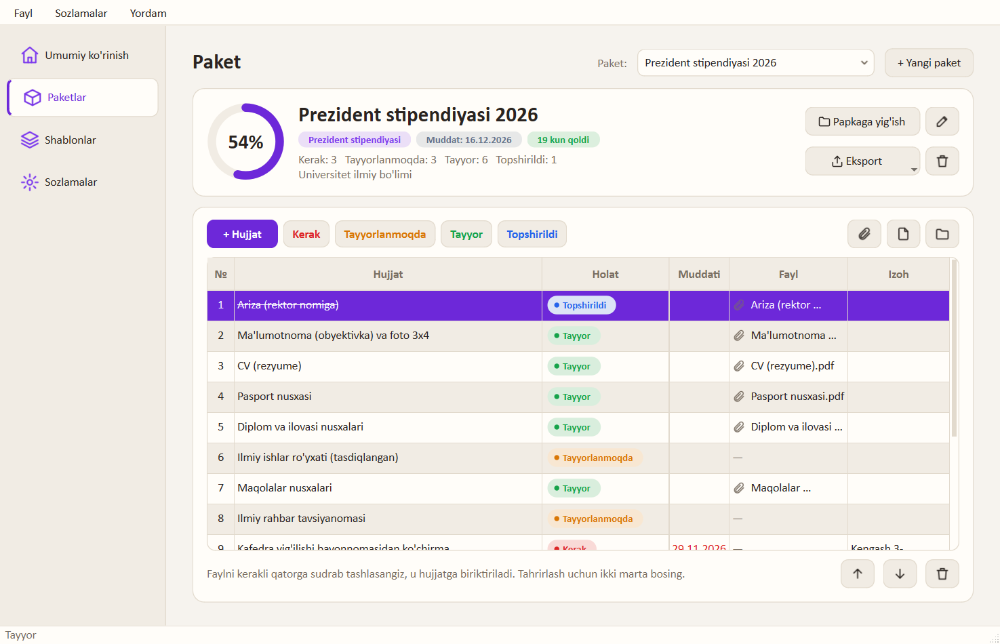
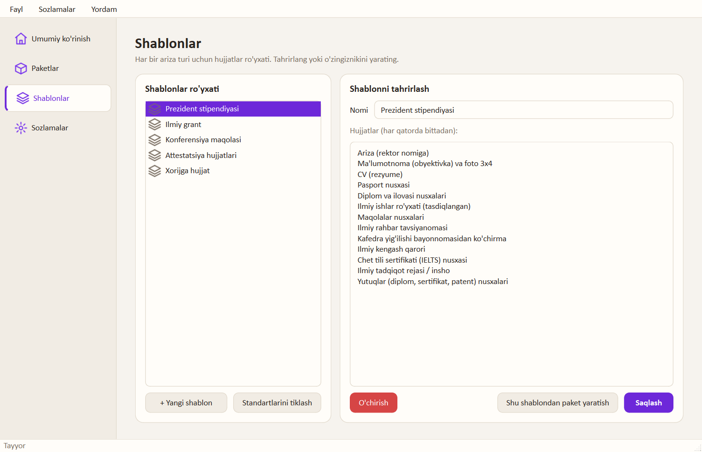
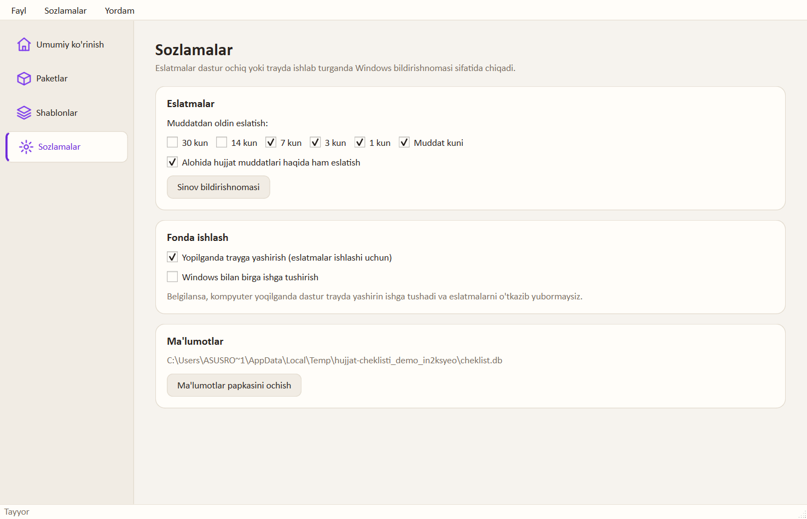

# Stipendiya va hujjat chek-listi: Uslubiy ko‘rsatma

Muallif: Hakimov Bahtiyorjon. Versiya: 1.0.2.

## 1. Uslubiy ko‘rsatmaning maqsadi va vazifalari

Ushbu uslubiy ko‘rsatma “Stipendiya va hujjat chek-listi” dasturidan oliy ta’lim muassasalari, kollej va texnikumlarda o‘quv mashg‘ulotlarida, shuningdek ilmiy bo‘lim, magistratura bo‘limi va xalqaro bo‘lim xodimlarining kasbiy faoliyatida foydalanish tartibini belgilaydi.

Maqsad – talabalar va yosh tadqiqotchilarda tanlov va jarayonlarga hujjat tayyorlashni loyiha sifatida rejalashtirish, bosqichlarni nazorat qilish, muddatlarga rioya qilish va raqamli hujjatlarni tartibli saqlash ko‘nikmalarini shakllantirish.

Vazifalar:

- stipendiya, grant, konferensiya va attestatsiya uchun talab qilinadigan hujjatlar tarkibi bilan tanishtirish;
- hujjat tayyorlash jarayonini bosqichlarga ajratish va holatlarni kuzatishni o‘rgatish;
- muddatlarni rejalashtirish va eslatmalardan foydalanishni ko‘rsatish;
- raqamli hujjatlarni nomlash, saqlash va topshirish uchun tartiblash madaniyatini shakllantirish;
- shaxsiy hujjatlar nusxalari bilan ishlashda xavfsizlik qoidalarini o‘rgatish.
Mashg‘ulotlar natijasida talaba o‘zi qatnashmoqchi bo‘lgan tanlov uchun hujjatlar ro‘yxatini tuza olishi, har bir hujjatni tayyorlash bosqichini kuzatishi, fayllarni tartibli nomlab bitta papkaga yig‘ishi va topshirish muddatini nazorat qila olishi kutiladi.

## 2. Qo‘llash sohasi va maqsadli auditoriya

Dasturdan quyidagi fanlar va faoliyat turlarida foydalanish tavsiya etiladi:

- “Ilmiy tadqiqot metodologiyasi”, “Ilmiy faoliyat asoslari”, “Akademik ko‘nikmalar” fanlari;
- “Loyihalarni boshqarish”, “Vaqtni boshqarish” fanlari va treninglar;
- “Informatika va axborot texnologiyalari” fanida ma’lumotlar bazasi (SQLite), fayllarni boshqarish va eksport formatlari mavzulari;
- magistratura va doktorantura bo‘limlari tomonidan o‘tkaziladigan stipendiya va grantlarga tayyorgarlik seminarlari;
- xalqaro bo‘limning xorijiy dasturlarga hujjat topshirish bo‘yicha maslahatlari.
Maqsadli auditoriya: bakalavriat va magistratura talabalari, tayanch doktorantlar, yosh olimlar, ilmiy rahbarlar, ilmiy bo‘lim, magistratura bo‘limi va xalqaro bo‘lim xodimlari.

Dasturdan kollej va texnikum o‘quvchilari bilan ham foydalanish mumkin: ular uchun mashg‘ulotni oliy ta’limga qabul hujjatlari yoki ishga kirish hujjatlari to‘plami misolida o‘tkazish tavsiya etiladi, buning uchun o‘qituvchi oldindan tegishli shablon yaratib qo‘yadi.

Kasbiy faoliyatda dastur ilmiy bo‘lim xodimiga muassasa nomidan grant arizasini tayyorlashda, kafedra mas’uliga talabalar hujjatlarini yig‘ishda, xalqaro bo‘lim xodimiga esa xorijiy hamkorlik dasturlari uchun hujjatlar to‘plamini tayyorlashda yordam beradi. Muassasaga xos talablar o‘z shablon sifatida saqlanib, xodimlar o‘rtasida hujjatlar ro‘yxati ko‘rinishida tarqatilishi mumkin.

Dastur o‘zbek, rus va ingliz tilidagi interfeysga ega, tayyor shablonlardagi hujjatlar nomlari ham uch tilda berilgan. Shu sababli undan turli ta’lim tillaridagi guruhlarda, shuningdek xorijiy talabalar bilan ishlashda ham foydalanish mumkin.

## 3. O‘quv mashg‘ulotida foydalanish tartibi

Quyida 80 daqiqalik amaliy mashg‘ulot rejasi keltirilgan. Mashg‘ulot kompyuter sinfida o‘tkaziladi, har bir kompyuterda dastur nusxasi bo‘ladi. O‘qituvchi oldindan namunaviy fayllar to‘plamini (ariza, rezyume, maqola nusxasi, ma’lumotnoma va boshqalar shartli mazmun bilan, PDF va Word formatlarida) tayyorlaydi. Haqiqiy shaxsiy hujjatlar nusxalari mashg‘ulotda ishlatilmaydi.

**Tashkiliy qism (5 daqiqa).** Davomat, mavzu va maqsadni e’lon qilish, namunaviy fayllar papkasini tarqatish.

**Nazariy qism (20 daqiqa).** Ilmiy faoliyatdagi tipik tanlovlar va ularga topshiriladigan hujjatlar; hujjat tayyorlash bosqichlari (kerak, tayyorlanmoqda, tayyor, topshirildi); umumiy va oraliq muddatlar; raqamli hujjatlarni nomlash va saqlash qoidalari; shaxsiy ma’lumotlarni himoyalash. O‘qituvchi tanlov e’lonidagi hujjatlar ro‘yxatini shablon bilan solishtirib ko‘rsatadi.

**Amaliy qism (45 daqiqa).**

1. “Prezident stipendiyasi” shablonidan paket yaratish, muddat qo‘yish va keraksiz hujjatlarni olib tashlash (7 daqiqa).
2. Namunaviy fayllarni hujjatlarga sudrab biriktirish va holatlarni o‘zgartirish (12 daqiqa).
3. Ikki hujjatga alohida muddat qo‘yish va “Umumiy ko‘rinish” sahifasida “Yaqinlashayotgan muddatlar” ni kuzatish (6 daqiqa).
4. Tanlov e’loniga mos o‘z shablonini yaratish va undan ikkinchi paket tuzish (10 daqiqa).
5. Eslatma sozlamalarini tanlash va sinov bildirishnomasini chiqarish (3 daqiqa).
6. Chek-listni PDF ga eksport qilish va fayllarni “Papkaga yig‘ish” orqali topshirish papkasiga to‘plash (7 daqiqa).
**Yakuniy qism (10 daqiqa).** Natijalarni ko‘rib chiqish: tayyorlik foizi, yig‘ilgan papkadagi fayllar nomi va tartibi, topilmagan fayllar; mustaqil ish topshirig‘ini berish. Mashg‘ulot oxirida namunaviy paketlar o‘chiriladi.

Mashg‘ulotga tayyorgarlik ko‘rishda o‘qituvchi dasturni barcha kompyuterlarga nusxalab, birinchi ishga tushirishni tekshiradi, namunaviy fayllar papkasini har bir kompyuterga joylaydi va muassasada amalda bo‘lgan bir-ikkita tanlov e’lonini tarqatma material sifatida chop etadi. Mashg‘ulotning kutilgan natijasi: har bir talabada kamida ikkita paket, bitta o‘z shabloni, PDF chek-list va topshirish papkasi.

Amaliy qism davomida o‘qituvchi talabalarga individual yordam beradi va tipik xatolarni (fayl noto‘g‘ri qatorga biriktirilgani, muddat kiritilmagani, holat yangilanmagani) qayd etib, yakuniy qismda muhokama qiladi.

*1-rasm. “Paketlar” sahifasi: “Prezident stipendiyasi 2026” paketi (54 %), holatlar bo‘yicha hisob, hujjatlar jadvali holat, muddat, biriktirilgan fayl va izoh ustunlari bilan*

## 4. Amaliy topshiriqlar

**1-topshiriq. Paket yaratish.** “Konferensiya maqolasi” shablonidan bir oydan keyingi muddat bilan paket yarating, tashkilot sifatida konferensiya tashkilotchisini kiriting. Kutilgan natija: paket “Umumiy ko‘rinish” sahifasida 0 % tayyorlik va qolgan kunlar bilan ko‘rinadi.

**2-topshiriq. Holatlar va tayyorlik.** Paketdagi hujjatlarning uchtasini “Tayyor”, bittasini “Topshirildi”, ikkitasini “Tayyorlanmoqda” holatiga o‘tkazing. Kutilgan natija: talaba tayyorlik foizini qo‘lda hisoblab, dastur ko‘rsatgani bilan solishtiradi va “Tayyorlanmoqda” holati foizga kirmasligini tushuntiradi.

**3-topshiriq. Fayl biriktirish.** Namunaviy fayllarni tegishli hujjatlarga sudrab biriktiring, so‘ng bitta faylni boshqa papkaga ko‘chiring. Kutilgan natija: ko‘chirilgan fayl nomi qizil rangda ko‘rsatiladi, talaba uni qayta biriktiradi.

**4-topshiriq. Alohida muddatlar.** “Ilmiy rahbar tavsiyanomasi” va “Kafedra yig‘ilishi bayonnomasidan ko‘chirma” hujjatlariga paket muddatidan oldingi alohida muddat qo‘ying. Kutilgan natija: ular “Yaqinlashayotgan muddatlar” ro‘yxatida paket bilan birga ko‘rinadi.

**5-topshiriq. O‘z shabloningiz.** Real tanlov e’loni (masalan, universitet ichki granti) asosida yangi shablon yarating, hujjatlarni e’londagi tartibda yozing va undan paket tuzing. Kutilgan natija: shablon “Shablonlar ro‘yxati” da, paket esa “Paketlar” da paydo bo‘ladi.

**6-topshiriq. Eslatmalar.** Eslatma chegaralarini “14 kun”, “3 kun” va “Muddat kuni” qilib sozlang va sinov bildirishnomasini chiqaring. Kutilgan natija: bildirishnoma chiqadi, talaba eslatmalar qachon va qanday sharoitda ishlashini tushuntiradi.

**7-topshiriq. Topshirish papkasi.** Fayllarni “Papkaga yig‘ish” orqali yangi papkaga to‘plang. Kutilgan natija: papkada fayllar tartib raqami va hujjat nomi bilan nomlangan, asl fayllar o‘z joyida.

**8-topshiriq. Hisobot.** Chek-listni PDF va Excel ga eksport qiling. Kutilgan natija: ikki fayl, ularda hujjatlar holati, muddati va tuzilgan sana ko‘rsatilgan.

*2-rasm. “Shablonlar” sahifasi: beshta tayyor shablon ro‘yxati va “Prezident stipendiyasi” shablonidagi hujjatlar ro‘yxatini tahrirlash*

## 5. Baholash mezonlari

Amaliy mashg‘ulot natijasi 100 ballik shkala bo‘yicha baholanadi:

- paketning to‘g‘ri yaratilishi (shablon, muddat, keraksiz hujjatlarni olib tashlash) – 15 ball;
- hujjat holatlarining to‘g‘ri belgilanishi va tayyorlik foizini izohlash – 15 ball;
- fayllarning to‘g‘ri biriktirilishi va topilmagan fayl holatini bartaraf etish – 15 ball;
- o‘z shablonining tanlov talablariga mos tuzilishi – 20 ball;
- eslatmalarning maqsadga muvofiq sozlanishi – 10 ball;
- topshirish papkasi va eksport fayllarining tayyorlanishi – 10 ball;
- nazorat savollariga javob – 15 ball.
86–100 ball – “a’lo”, 71–85 ball – “yaxshi”, 55–70 ball – “qoniqarli”, 55 balldan kam – “qoniqarsiz”.

Baholashda o‘qituvchi yig‘ilgan papkani va PDF chek-listni ko‘rib chiqadi, talabadan esa tanlangan holat va muddatlar sababini og‘zaki izohlashni so‘raydi. Juftlikda ishlaganda har bir talaba kamida bitta paketni mustaqil tuzgan bo‘lishi kerak.

Baholash natijalari talabaga izoh bilan yetkaziladi: qaysi hujjat ro‘yxatdan tushib qolgani, qaysi muddat noto‘g‘ri rejalashtirilgani yoki qaysi fayl noto‘g‘ri nomlangani ko‘rsatiladi. Bu izohlar mustaqil ishni bajarishda yo‘l-yo‘riq bo‘lib xizmat qiladi.

## 6. Nazorat savollari

1. Prezident stipendiyasi yoki ilmiy grant uchun odatda qanday hujjatlar talab qilinadi?
2. Dasturda hujjat qanday holatlarda bo‘lishi mumkin va ularning har biri nimani bildiradi?
3. Paket tayyorligi foizi qanday hisoblanadi?
4. Paket muddati va alohida hujjat muddati qanday farqlanadi?
5. Eslatmalar qaysi chegaralarda chiqishi mumkin va nima uchun bir eslatma takrorlanmaydi?
6. Eslatmalar ishlashi uchun dastur qanday holatda bo‘lishi kerak?
7. Biriktirilgan fayl ko‘chirilsa yoki o‘chirilsa nima bo‘ladi?
8. “Papkaga yig‘ish” fayllarni qanday nomlaydi va asl fayllarga ta’sir qiladimi?
9. Shablonni o‘zgartirish mavjud paketlarga ta’sir qiladimi? Nima uchun?
10. Dastur ma’lumotlarni qayerda saqlaydi va baza buzilsa nima sodir bo‘ladi?

## 7. Mustaqil ish uchun tavsiyalar

- O‘zingiz qatnashmoqchi bo‘lgan real tanlov uchun paket yarating va hujjatlar ro‘yxatini tanlov e’loni bilan solishtiring.
- Har bir hujjatni tayyorlash uchun kim bilan bog‘lanish kerakligini “Izoh” maydoniga yozing (masalan, “ilmiy rahbar”, “kafedra kotibi”).
- Har hafta “Umumiy ko‘rinish” sahifasini ko‘rib chiqing va tayyorlik foizi past, muddati yaqin paketlarga birinchi navbatda e’tibor bering.
- Hujjat fayllarini tanlov talab qiladigan formatda (masalan, PDF) tayyorlang va fayl hajmi cheklovlariga e’tibor bering; dastur fayl formatini o‘zgartirmaydi.
- Imzo va muhr talab qiladigan hujjatlarga paket muddatidan bir necha kun oldingi alohida muddat qo‘ying.
- Skanerlangan hujjatlarni bir papkada, tushunarli nomlar bilan saqlang va ularni darhol biriktiring.
- Topshirishdan oldin “Papkaga yig‘ish” natijasini tekshiring va fayllarni tanlov talab qilgan formatda ekanini ko‘zdan kechiring.
- Bir semestr davomida barcha tanlov va konferensiyalar paketlarini dasturda yuriting va semestr oxirida natijalarni tahlil qiling: qaysi hujjatlar ko‘proq vaqt talab qildi.
- Mustaqil ish natijasini PDF chek-list va yig‘ilgan papka ko‘rinishida topshiring.
- Guruhdoshingiz bilan o‘z shabloningizni solishtiring: bir xil tanlov uchun tuzilgan ro‘yxatlar qanchalik farq qiladi va qaysi hujjatlar e’tibordan chetda qolgan.
- Tanlov yakunlangandan so‘ng paketni o‘chirmasdan saqlab qo‘ying: keyingi yil xuddi shu tanlovga tayyorlanishda u tayyor reja bo‘lib xizmat qiladi.

## 8. Xavfsizlik va axborot madaniyati qoidalari

- Dasturni faqat rasmiy GitHub sahifasidan yuklab oling va noma’lum manbalardagi nusxalardan foydalanmang.
- O‘quv mashg‘ulotlarida haqiqiy pasport, diplom va boshqa shaxsiy hujjatlar nusxalaridan foydalanmang; faqat shartli namunaviy fayllar bilan ishlang.
- Shaxsiy hujjatlaringiz nusxalarini umumiy foydalanishdagi kompyuterlarda, umumiy papkalarda va fleshkalarda qoldirmang.
- Hujjatlar nusxalarini saqlashda ularning zaxira nusxasini alohida diskda yoki ishonchli omborda saqlang.
- Topshirish papkasini elektron pochta yoki boshqa kanal orqali yuborishda faqat rasmiy manzillardan foydalaning va qabul qiluvchini tekshiring.
- Avtomatik ishga tushirishni faqat shaxsiy kompyuterda yoqing; umumiy foydalanishdagi kompyuterda u keyingi seanslarda ham dasturni avtomatik ochib, sizning paketlaringiz ro‘yxatini boshqa shaxslarga ko‘rsatishi mumkin.
- Tanlov talablarini rasmiy e’londan tekshiring: dastur shablonlari umumlashtirilgan va rasmiy talablar o‘rnini bosmaydi.
- Hujjatlardagi ma’lumotlarning to‘g‘riligi va haqqoniyligi uchun ularni topshirgan shaxs javobgar; soxta yoki o‘zgartirilgan hujjatlar topshirish qonunga ziddir.
- Dastur o‘chirish amallaridan oldin tasdiq so‘raydi; tasdiq oynasidagi matnni diqqat bilan o‘qing, ayniqsa “Standartni tiklash” amalida.
- Biriktirilgan fayllarni o‘z kompyuteringizda tartibli papkalar tizimida saqlang: masalan, har bir tanlov uchun alohida papka. Bu fayllarning yo‘qolishi va noto‘g‘ri biriktirilishining oldini oladi.
- Kompyuter sinfida elektr va texnika xavfsizligi qoidalariga rioya qiling.

*3-rasm. “Sozlamalar” sahifasi: muddatdan oldin eslatish kunlari, “Fonda ishlash” va “Ma’lumotlar” bo‘limlari*

